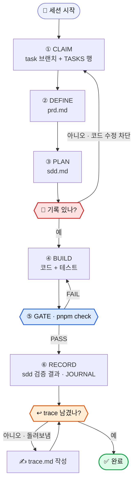
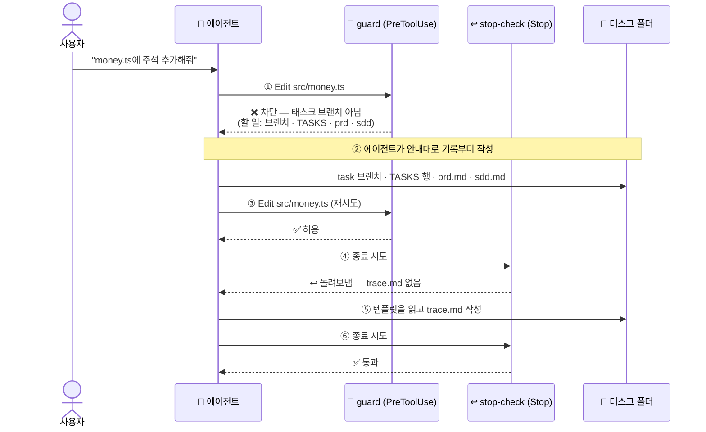

<div align="center">

# 🧪 harness-lab

**AI 코딩 에이전트가 "무엇을, 왜, 어떻게 했는지" 남기지 않고는 일을 끝낼 수 없게 만드는 하네스 실험실**

에이전트의 작업 과정을 기록으로 열고(블랙박스 해제), 그 기록을 hooks와 게이트로 강제합니다.

<br>


</div>

> [!NOTE]
> 이 저장소는 **제품이 아니라 하네스를 연구하고 공부하는 실험실**입니다. 쇼핑몰 할인·주문 엔진은 하네스를 시험하기 위한 **실험 대상 도메인**입니다.

---

## 📑 목차

[연구 한눈에 보기](#-연구-한눈에-보기) · [실험 현황](#-실험-현황) · [왜 만들었나](#-왜-만들었나) · [핵심 아이디어](#-핵심-아이디어) · [작업 루프](#-작업-루프) · [강제 장치](#%EF%B8%8F-강제-장치) · [태스크 기록](#-태스크-기록) · [발견한 것](#-발견한-것) · [실험 대상 도메인](#-실험-대상-도메인) · [저장소 구조](#%EF%B8%8F-저장소-구조) · [기술 스택](#-기술-스택) · [실행 방법](#%EF%B8%8F-실행-방법) · [로드맵](#%EF%B8%8F-로드맵)

---

## 🔬 연구 한눈에 보기

> AI 코딩 에이전트에게 규칙을 **"말로 지시하는 것"과 "장치로 강제하는 것"이 실제로 얼마나 다른지**를 연구합니다.
> 같은 과제를 조건만 바꿔 여러 번 돌리고, 결과를 숫자로 비교합니다.

### 무엇을 묻고 있나

| 갈래 | 연구 질문 | NO |
| --- | --- | --- |
| 🛡️ 기록 강제 | 장치로 막으면 작업 과정을 남기는가 | 0008 · 0009 · 0017 · 0020 · 0021 |
| 👥 역할 분리 | 역할을 나누면 혼자보다 정확한가 | 0012~0016 · 0022 · 0023 |
| ❓ 애매한 요청 | 빈칸이 있으면 묻는가, 지어내는가 | 0024~0030 · 0032~0034 |
| 📏 측정 | 효과를 재는 도구는 믿을 만한가 | 0019 · 0031 |

### 지금까지 알게 된 것

👉 주제별 결과와 수치는 아래 **[실험별 상태](#실험별-상태)** 에 있습니다 — 역할 분리 · 애매한 요청 · 모델별 비용 · 장치로 묻게 하기 · 측정 · 실전 규칙

### 어떻게 실험하나

- 저장소를 그 시점 그대로 복사한 **깨끗한 복사본**에서 AI를 조건별로 여러 번 돌립니다.
- AI가 볼 수 없는 테스트와 판정 AI로 결과를 재고, 대화 기록과 자동 기록(`trace.auto.jsonl`)을 **직접 열어** 숫자를 확인합니다.
- 실험마다 가설·결과는 [LEARNINGS.md](LEARNINGS.md), 과정은 태스크 폴더(`prd`·`sdd`·`trace`)에 남깁니다.

### 자세히 볼 곳

- 🔬 [LEARNINGS.md](LEARNINGS.md) — 실험별 가설·결과 전체
- 🗒️ [agents/JOURNAL.md](agents/JOURNAL.md) — 태스크 목차 (결과·허점 한 줄씩)
- 🧪 [experiments/](experiments/) — 실험 장치와 실행 결과
- 🛡️ [agents/harness/guardrails.md](agents/harness/guardrails.md) — 지금 동작하는 강제 장치 목록

---

## 📊 실험 현황

<sup>업데이트: **2026-10-13**</sup>

> **지금 하는 것** — 애매한 요청에서 AI가 지시 없이도 사람에게 묻게 만드는 장치 (업무 값 확인 규칙 + 확인 표시 대조).
> 다음은 그 장치의 남은 구멍("알아서 정해 주세요" 답·칸 덮기)을 막고, 다른 의도로 다시 재 보기입니다.

| 영역 | 진행 |
| --- | --- |
| 🧪 실험 | **29개 완료** · 3개 대기 |
| 🛡️ 강제 지점 | **6곳** — 시작 · 입력 · 수정 · 종료 · 커밋 · 게이트 |
| ✅ 게이트 | **ALL PASS** — 타입 · 테스트 156개 · 기록 · 실험 장치 |
| 🛒 도메인 | 장바구니·금액 계산 (주문 상태는 미구현) |

### 실험별 상태

<sup>Claude Code · 따로 적지 않으면 Haiku 4.5 · 조건마다 3회 · NO를 누르면 PR</sup>

#### 👥 역할 분리 — 나누는 것보다 **원문을 그대로 넘기는 것**이 핵심

| NO | 방식 | 숨겨진 테스트 | 비고 |
| --- | --- | --- | --- |
| [0016](https://github.com/kyungchan3007/Harness/pull/23) | 혼자 | 20.3 / 21 | 기준 |
| [0016](https://github.com/kyungchan3007/Harness/pull/23) | 역할 분리 + 요약 전달 | **9.7** / 21 | 요구가 사라짐 |
| [0016](https://github.com/kyungchan3007/Harness/pull/23) | 역할 분리 + 원문 전달 | 21 / 21 | 시간 2.5배 · 비용 2.2배 |
| [0022](https://github.com/kyungchan3007/Harness/pull/25) | 역할 분리 + 원문 고정 장치 | 21 · 21 · 21 | 요약 전달보다 싸고 빠름 |

- 요약해서 넘기면 설계 AI가 규칙을 지어내고, 검사 AI도 그 기준으로 통과시킨다 (결함 16~17개 놓침)
- 검사 AI가 실제로 잡은 결함은 9번 중 1건
- 원문 고정의 차단은 한 번도 걸리지 않음 — 효과는 원문 파일과 "먼저 읽어라", 차단은 안전망

#### ❓ 애매한 요청 — 작은 모델은 빈칸을 몰래 채운다, **묻고 답을 받아야** 맞는다

| NO | 조건 | 결과 |
| --- | --- | --- |
| [0024](https://github.com/kyungchan3007/Harness/pull/29) | 평소 | 애매한 곳의 **95%를 몰래 정함** |
| [0024](https://github.com/kyungchan3007/Harness/pull/29) | "모호하면 물어라" 한 줄 | 86% 되물음 · 비용 1/4 |
| [0025](https://github.com/kyungchan3007/Harness/pull/33) | 필수 칸 | 몰래 정함 95% → 57% |
| [0026](https://github.com/kyungchan3007/Harness/pull/34) | 큰 모델 | Sonnet·Opus 10%, Opus는 시키지 않아도 물음 |
| [0027](https://github.com/kyungchan3007/Harness/pull/35) | 묻고 → 답 → 이어 가기 | 숨겨진 테스트 27% → **87%** |
| [0028](https://github.com/kyungchan3007/Harness/pull/37) | 큰 모델 + 대화형 | **100%** (Sonnet·Opus) |
| [0030](https://github.com/kyungchan3007/Harness/pull/42) | 흔하지 않은 정답 의도 | 추측 41% → **4%** · 대화형 Opus 100% |

- "결제 금액에 배송비 포함?" 같은 흔한 말의 숨은 뜻 — Haiku 9번 모두 놓침, 큰 모델 15번 모두 짚음
- 추측의 점수는 착시 — 정답 의도가 흔해서 맞았을 뿐

#### 💰 모델별 비용 — 큰 모델이 꼭 비싸지 않다, 비용은 **단가 × 쓴 양**

| NO | 조건 (대화형) | 1번 비용 | 요청 수 |
| --- | --- | --- | --- |
| [0027](https://github.com/kyungchan3007/Harness/pull/35) | Haiku | 약 \$0.41 | 26번 |
| [0028](https://github.com/kyungchan3007/Harness/pull/37) | Sonnet | \$1.41 | 12~16번 |
| [0028](https://github.com/kyungchan3007/Harness/pull/37) | **Opus** | **\$0.98** | 10번 |
| [0029](https://github.com/kyungchan3007/Harness/pull/39) | 설계 Opus + 구현 Haiku | \$1.35 | - |

- 조합은 정확도 100%로 같지만 전부 Opus보다 약 1.4배 비쌈
- 비싼 건 구현(Haiku \$0.28)이 아니라 넘길 문서 쓰기(Opus \$0.73) — 작은 작업은 큰 모델 하나로 끝까지

#### 🛡️ 장치로 묻게 하기 — 장치는 지시를 대신하지 못하지만 **위조는 막는다**

| NO | 방식 | 사람에게 물음 | 위조 통과 | 숨겨진 테스트 |
| --- | --- | --- | --- | --- |
| [0025](https://github.com/kyungchan3007/Harness/pull/33) | 필수 칸만 | 0/3 | - | 53% |
| [0033](https://github.com/kyungchan3007/Harness/pull/49) | 업무 값 가정 금지 | 2/3 | 1 | 73% |
| [0034](https://github.com/kyungchan3007/Harness/pull/51) | + 확인됨을 대화 기록과 대조 | **3/3** | **0** | **80%** |
| [0027](https://github.com/kyungchan3007/Harness/pull/35) | "물어라" 지시 | 3/3 | - | 87% |

#### 📏 측정과 기록

| NO | 알게 된 것 | 근거 |
| --- | --- | --- |
| [0009](https://github.com/kyungchan3007/Harness/pull/3) | 기록은 지시보다 **장치**로 강제해야 남는다 | 차단 안내만으로 스스로 기록 |
| [0031](https://github.com/kyungchan3007/Harness/pull/44) | 측정 도구도 틀린다 | "체크해줘" 도구 8회 → 실제 0회 |

#### 🧭 실전 규칙으로 줄이면

1. 작은 작업은 **Opus 하나로 끝까지**
2. 요청이 애매하면 **묻고 답을 받은 뒤** 구현 — 작은 모델이면 지시 + 장치 함께
3. 역할을 나눌 땐 요약 말고 **원문을 고정**해서 넘기기
4. "확인됨" 같은 자기 신고 표시는 **원본(대화 기록)과 대조**
5. 측정 숫자가 이상하면 **원본 몇 건을 직접** 열기

<sup>작업 번호별 전체 목록: [agents/orchestration/TASKS.md](agents/orchestration/TASKS.md) · 실험별 가설·결과: [LEARNINGS.md](LEARNINGS.md)</sup>

---

## 💡 왜 만들었나

| 문제 | 이 저장소의 답 |
| --- | --- |
| 작업 과정이 **블랙박스**다 | 태스크마다 prd · sdd · trace + **자동 기록** |
| 기록 규칙을 써도 **건너뛴다** | 기록 없으면 수정·종료·완료 **불가** |
| 실제 프로젝트에선 루프가 흔들린다 | 하네스만 떼어 낸 **연구용 샌드박스** |
| 쉬운 도메인에선 **틀리지 않는다** | 함정 많은 **쇼핑몰 할인·주문 엔진** |

---

## ✨ 핵심 아이디어

1. **🔍 블랙박스 열기** — 에이전트가 무엇을 읽고, 어디서 막히고, 무엇을 되돌렸는지를 태스크 폴더에 남깁니다.
2. **🛡️ 규칙이 아니라 장치로 강제** — "PRD 먼저 쓰세요"를 문서에 쓰는 대신, PRD 없이 코드를 고치면 **hook이 막습니다.**
3. **⚖️ 자기 보고 vs 사실 기록** — 에이전트가 쓴 `trace.md`와 hooks가 남긴 `trace.auto.jsonl`을 나란히 놓으면 **보고에서 빠진 헤맴**이 드러납니다.
4. **🔬 실험은 가설과 결론으로** — 실험마다 가설·결과를 [LEARNINGS.md](LEARNINGS.md)에 쌓습니다.

---

## 🔁 작업 루프

> **한 줄 요약** — 태스크를 점유하고 → PRD·SDD를 쓴 뒤에야 → 코드를 고칠 수 있고 → 게이트를 통과하고 → trace를 남겨야 끝낼 수 있습니다.



**단계 (그림의 번호와 동일)**

1. **CLAIM** — **이슈를 먼저 만들고** 그 이슈에서 `task/NNNN-슬러그` 브랜치를 만들어(`gh issue develop`) `TASKS.md`에 행을 추가합니다. 기존 이슈의 fix는 그 이슈에서 `fix/NNNN-슬러그`. ([지침서](agents/harness/branch-and-issue.md))
2. **DEFINE** — `prd.md`에 왜·무엇·Acceptance를 씁니다.
3. **PLAN** — `sdd.md`에 접근·대안·검증 계획을 씁니다.
4. **BUILD** — 코드와 테스트를 작성합니다.
5. **GATE** — `pnpm check`가 PASS할 때까지 반복합니다.
6. **RECORD** — `sdd.md`에 계획과 달라진 점·검증 결과, JOURNAL에 한 줄.

**강제 지점 (그림의 색)**

| 색 | 지점 | 없으면 |
| --- | --- | --- |
| 🟥 | 🛑 코드 수정 직전 | 브랜치·TASKS·prd·sdd 없으면 **차단** |
| 🟦 | ⑤ 게이트 | 타입·테스트·기록 실패면 **FAIL** |
| 🟧 | ↩️ 종료 직전 | trace 없으면 **돌려보냄** |

**작업 내내 남는 기록**

| 기록 | 누가 |
| --- | --- |
| ✍️ `trace.md` — 판단·막힘·되돌림 | 에이전트 |
| 🤖 `trace.auto.jsonl` — 도구 호출 | hooks 자동 |

---

## 🛡️ 강제 장치

> **한 줄 요약** — 네 지점에서 기록을 확인합니다. 판정 기준은 [`records.mjs`](agents/harness/hooks/lib/records.mjs) 한 곳에 있어 hook과 게이트가 어긋나지 않습니다.

| 지점 | 장치 | 하는 일 |
| --- | --- | --- |
| 🔔 세션 시작 | `session-context` · `recall-hook` | 작업 상태 + 지난 `[보완]` 주입 |
| 🛑 수정 직전 | `guard` | 기록이 없으면 **수정 차단** |
| ↩️ 응답 종료 | `stop-check` | trace가 없으면 **돌려보냄** |
| ✅ 완료 선언 | `check-task-records` | 기록·타입·테스트 **FAIL** |

<sub>수정 직전에 보는 것: 태스크 브랜치 · TASKS 행 · 채워진 prd·sdd · 애매한 곳 칸 · 확인 표시 대조</sub>

### 실제로 에이전트가 겪는 흐름

아래는 실제 Claude 세션으로 돌린 e2e 결과를 그대로 옮긴 것입니다. ([원본 기록](agents/intent/specs/0009-record-enforcement/e2e/))



<sub>e2e는 두 시나리오로 나눠 확인했습니다: A(①의 차단) · B(③~⑥, prd·sdd가 있는 상태에서 시작).</sub>

- 🔓 **기록 경로는 항상 수정 가능** — `agents/intent/` · `agents/orchestration/` · `JOURNAL.md` · `LEARNINGS.md`. 그 밖은 모두 코드로 봅니다(하네스 파일 포함).
- 🧾 **템플릿 그대로면 미작성** — 제목 자리표시, 빈 Acceptance, 빈 접근·대안·검증 계획, 빈 trace 행을 잡아냅니다.
- ⚠️ **한계** — Bash로 쓰는 파일은 사전 차단 못 함(Stop·게이트가 사후에 잡음) · 기록의 **형식**만 검사.

---

## 📂 태스크 기록

태스크마다 `agents/intent/specs/NNNN-슬러그/` 폴더 하나에 네 가지 기록이 남습니다.

| 파일 | 담는 것 | 누가 |
| --- | --- | --- |
| `request.md` | 이슈 본문 원문 (고정) | 🤖 명령 |
| `prd.md` | 왜 · 무엇을 · 애매한 곳 · Acceptance | ✍️ 에이전트 |
| `sdd.md` | 어떻게 · 대안 · **달라진 점** · 결과 | ✍️ 에이전트 |
| `trace.md` | 판단 · 막힘 · 되돌림 | ✍️ 에이전트 |
| `trace.auto.jsonl` | 도구 호출 · 성공/실패 · **차단** | 🤖 hooks |

### 자동 기록 예시

hooks가 남긴 실제 기록입니다. **차단된 순간**도 남습니다.

```jsonc
// 🛑 guard가 막은 코드 수정
{"event":"PreToolUse","tool":"Edit","detail":"src/money.ts","ok":false,"blocked":true,
 "error":"[기록 강제] src/money.ts 수정 차단: 현재 브랜치(exp-not-a-task)가 태스크 브랜치가 아닙니다."}

// ↩️ Stop이 돌려보낸 순간
{"event":"StopBlocked","ok":false,"blocked":true,
 "error":"agents/intent/specs/0042-e2e-stop/trace.md 가 없습니다 ..."}
```

`pnpm trace NNNN`으로 표로 요약해 볼 수 있습니다.

```
| 시각     | 이벤트            | 도구 | 내용                                  |
| 09:07:50 | PostToolUse       | Edit | src/money.ts                          |
| 09:07:53 | StopBlocked       |      | 🛑 차단 ❌ trace.md 가 없습니다 ...     |
| 09:08:10 | PostToolUse       | Write| agents/intent/specs/0042-.../trace.md |
| 09:08:16 | Stop              |      |                                       |
```

### 커밋·이슈·PR에 남기는 것

태스크 커밋에는 코드 변경과 함께 세 섹션을 남깁니다. 없으면 `commit-msg` hook이 커밋을 거부하고, 토큰 섹션은 `prepare-commit-msg` hook이 **transcript 실측값으로 자동으로** 채웁니다. ([지침서](agents/harness/commit-and-issue.md))

```
[허점]
- 커밋 전 메시지는 게이트가 볼 수 없어 hook으로만 강제된다

[보완]
- CI에서도 PR 커밋 메시지 검사

[컨텍스트·토큰]
- 범위: 브랜치 task/0017-commit-issue-guide 누적 · 세션 1개 · 요청 2회 · 모델 claude-haiku-4-5
- 토큰: 입력 18 · 캐시 쓰기 43.0k · 캐시 읽기 34.8k · 출력 432
- 컨텍스트: 최대 43.0k · 마지막 43.0k
- 읽은 파일: 1개
```

> 🔐 **public repo 대비** — 도구 결과(파일 내용·출력)는 남기지 않고, 비밀값 패턴은 `[REDACTED]`로 가리고, 경로는 상대 경로로 바꿔 200자로 자릅니다.

---

## 🔬 발견한 것

실험하면서 알게 된 것들입니다. 전체 목록: [LEARNINGS.md](LEARNINGS.md)

| # | 발견 | 조치 |
| --- | --- | --- |
| 1 | 쉬운 도메인에선 에이전트가 **틀리지 않는다** | 함정 많은 쇼핑몰로 전환 |
| 2 | 폴더를 안 만들면 게이트를 **통과했다** | 폴더 존재부터 검사 |
| 3 | 막힌 순간이 **기록에서 빠졌다** | 차단 때 hook이 직접 기록 |
| 4 | 차단 안내만 보고 **스스로 기록**했다 | 안내에 풀리는 방법을 구체적으로 |
| 5 | 나중에 쓴 trace는 **결과에 꿰맞춘다** | 재구성 금지, 누락만 표기 |
| 6 | (0016) 요약해서 넘기면 **규칙을 지어낸다** | 원문 고정 강제 (0022) |
| 7 | (0020) 이슈·prd 체크박스가 **당일에 어긋남** | prd 원본 + 동기화 명령 |
| 8 | (0024) 흔한 말의 **숨은 뜻**을 못 본다 | 큰 모델·묻고 답 받기로 비교 |
| 9 | (0031) 측정 도구가 **엉뚱한 글까지** 셌다 | 직접 친 글만 세게 정정 |
| 10 | (0033) 막히자 **확인 표시를 지어냈다** | 대화 기록과 대조 (0034) |

---

## 🛒 실험 대상 도메인

**쇼핑몰 할인·주문 엔진** — 규칙이 얽히고 경계값이 많아 에이전트가 틀리기 쉬운 도메인입니다. 규칙의 단일 소스는 [domain.md](agents/context/domain.md)이고, 테스트 이름에 규칙 번호를 붙여 추적합니다.

| 규칙 | 내용 |
| --- | --- |
| 금액 | 항상 0 이상의 정수(원) |
| 수량 | 1~99, 같은 상품을 다시 담으면 합산 (99 초과 거부) |
| 배송비 | 3,000원, **할인 후** 50,000원 이상이면 무료 |
| 할인 | 0 이상, 상품 합계를 넘을 수 없음 |

```ts
priceCart([{ sku: "A", name: "상품", unitPrice: 52_000, quantity: 1 }], { discount: 2_001 });
// → { subtotal: 52000, discount: 2001, shipping: 3000, total: 52999 }
//   할인 후 49,999원 → 무료배송 기준 미달
```

---

## 🗂️ 저장소 구조

```
harness-lab/
├─ AGENTS.md · CLAUDE.md        # 🚪 에이전트 진입점 (항상 로드, 짧게)
├─ LEARNINGS.md                 # 🔬 실험 가설 · 결과
├─ src/                         # 🛒 실험 대상 도메인 (장바구니 · 금액 계산)
├─ .claude/settings.json        # 🪝 hooks 등록
└─ agents/
   ├─ intent/                   # 🎯 무엇을 만드나
   │  ├─ specs/NNNN-*/          #    prd · sdd · trace · trace.auto.jsonl
   │  └─ templates/             #    prd · sdd · trace 템플릿
   ├─ context/                  # 📚 무엇이 참인가 (architecture · domain)
   ├─ harness/                  # ⚙️ 어떻게 안전하게 돌리나
   │  ├─ hooks/                 #    trace · guard · stop-check · session-context
   │  └─ evals/                 #    완료 게이트
   ├─ orchestration/TASKS.md    # 📋 작업 보드
   └─ JOURNAL.md                # 🗒️ 태스크 목차
```

| 계층 | 동사 | 문서 |
| --- | --- | --- |
| Intent | 정의한다 | [templates](agents/intent/templates/) |
| Context | 안다 | [architecture](agents/context/architecture.md) · [domain](agents/context/domain.md) |
| Harness | 실행한다 | [loop](agents/harness/loop.md) · [guardrails](agents/harness/guardrails.md) · [observability](agents/harness/observability.md) |
| Orchestration | 엮는다 | [TASKS](agents/orchestration/TASKS.md) |

---

## 🧱 기술 스택

| 구분 | 기술 | 역할 |
| --- | --- | --- |
| 언어 | TypeScript (strict · ESM) | 도메인 코드 |
| 런타임 | Node.js 22 | hooks · 게이트 (의존성 없는 `.mjs`) |
| 테스트 | Vitest | 도메인 규칙 · hook 판정 로직 |
| 에이전트 | Claude Code · Codex | `AGENTS.md` 단일 진입점을 공유 |
| 하네스 | Claude Code hooks | 6종 (SessionStart · PreToolUse · Stop 등) |
| 패키지 | pnpm | 다른 lockfile은 게이트에서 차단 |

---

## ▶️ 실행 방법

```bash
pnpm install
pnpm check        # 완료 게이트: 타입 · 테스트 · lockfile · 태스크 기록
pnpm trace 0009   # 태스크의 hooks 자동 기록 요약
pnpm usage        # 현재 태스크 브랜치의 토큰·컨텍스트 사용량 (transcript 실측)
pnpm metrics --project <경로> --repo <owner/name>   # 복기 참조율·체크박스 방치율 측정
pnpm issue-link   # 현재 브랜치가 prd의 이슈에 연결됐는지 확인 (PR 전)
pnpm issue-sync   # 이슈 체크박스를 prd.md Acceptance에 맞춤 (--check 검사 · --close <이슈번호> 머지 후 닫기)
```

hooks는 **이 폴더에서 Claude Code 세션을 열면** 자동으로 동작합니다 ([.claude/settings.json](.claude/settings.json)).
새 작업은 `task/NNNN-슬러그` 브랜치와 [템플릿](agents/intent/templates/)부터 시작하세요. 그렇지 않으면 hook이 막습니다.

---

## 🗺️ 로드맵

| # | 실험 | 계층 | 상태 |
| --- | --- | --- | --- |
| 1 | 4계층 뼈대 + 완료 게이트 | 전체 | ✅ |
| 2 | 과정 기록 (prd·sdd·trace + 자동 기록) | Observability | ✅ |
| 3 | 기록 강제 (수정·종료·커밋·게이트) | Guardrails | ✅ |
| 4 | 역할 분리 + 원문 고정 (0012~0023) | Orchestration | ✅ |
| 5 | 애매한 요청 실험 (0024~0030) | Intent | ✅ |
| 6 | 애매한 요청을 장치로 (0032~0034) | Guardrails | ✅ |
| 7 | 측정 도구와 정정 (0019·0031) | 검증 | ✅ |
| 8 | 장치의 남은 구멍 (0034 후속) | Guardrails | 🔜 |
| 9 | 속성 기반 테스트 게이트 | Eval | ⬜ |
| 10 | 서브에이전트 병렬 작업 | Orchestration | ⬜ |
| 11 | CI에서 게이트 실행 | Eval | ⬜ |
| 12 | 기록 **내용 품질** 판정 | Eval | ⬜ |

<sup>범례: ✅ 완료 · 🔜 다음 · ⬜ 대기</sup>

--- | --- | --- | --- |
| 1 | 4계층 뼈대 + 완료 게이트 (0001) | 전체 | ✅ 완료 |
| 2 | 과정 기록 — PRD·SDD·Trace + hooks 자동 기록 (0008) | Observability | ✅ 완료 |
| 3 | 기록 강제 — 수정 직전·종료·커밋·게이트 (0009·0017·0020·0021) | Guardrails · Eval | ✅ 완료 |
| 4 | 역할 분리 + 원문 고정 (0012~0016·0022·0023) | Orchestration | ✅ 완료 |
| 5 | 애매한 요청 — 되묻기·필수 칸·큰 모델·대화형·조합 (0024~0030) | Intent | ✅ 완료 |
| 6 | 애매한 요청을 장치로 — 업무 값 확인·확인 표시 대조 (0032~0034) | Guardrails | ✅ 완료 |
| 7 | 측정 도구와 그 정정 (0019·0031) | 검증 | ✅ 완료 |
| 8 | 애매한 요청 장치의 남은 구멍 — 위임 답·칸 덮기·다른 정답 의도로 재측정 (0032~0034 후속) | Guardrails | 🔜 다음 |
| 9 | 속성 기반 테스트 게이트 (주문 상태) | Eval | ⬜ 대기 |
| 10 | 서브에이전트 병렬 작업 (할인·배송 분리) | Orchestration | ⬜ 대기 |
| 11 | CI에서 게이트 실행 | Eval | ⬜ 대기 |
| 12 | 기록 **내용 품질** 판정 (LLM-as-judge) | Eval | ⬜ 대기 |

--- | --- | --- | --- |
| 1 | 4계층 뼈대 + 완료 게이트 | 전체 | ✅ 완료 |
| 2 | 과정 기록 (PRD·SDD·Trace + hooks 자동 기록) | Observability | ✅ 완료 |
| 3 | 기록 강제 (PreToolUse·Stop·게이트) | Guardrails · Eval | ✅ 완료 |
| 4 | 대화형 전체 흐름 관찰 (0027: 묻고 → 답 → 이어 가기는 확인) | 검증 | 🔜 다음 |
| 5 | 모호한 요청에 되묻는가 (0024, 포인트 적립) — 평소 95% 몰래 지어냄, "물어보라" 한 줄이면 86% 되물음 | Intent | ✅ 완료 |
| 6 | 속성 기반 테스트 게이트 (주문 상태) | Eval | ⬜ 대기 |
| 7 | 서브에이전트 병렬 작업 (할인·배송 분리) | Orchestration | ⬜ 대기 |
| 8 | CI에서 게이트 실행 | Eval | ⬜ 대기 |
| 9 | 기록 **내용 품질** 판정 (LLM-as-judge) | Eval | ⬜ 대기 |

---

<div align="center">
<sub>🤖 이 저장소도 자신이 실험하는 하네스(<a href="AGENTS.md">AGENTS.md</a>) 규칙을 따라 Claude Code로 개발됩니다 — 모든 변경은 태스크 폴더에 기록이 남습니다.</sub>
</div>
